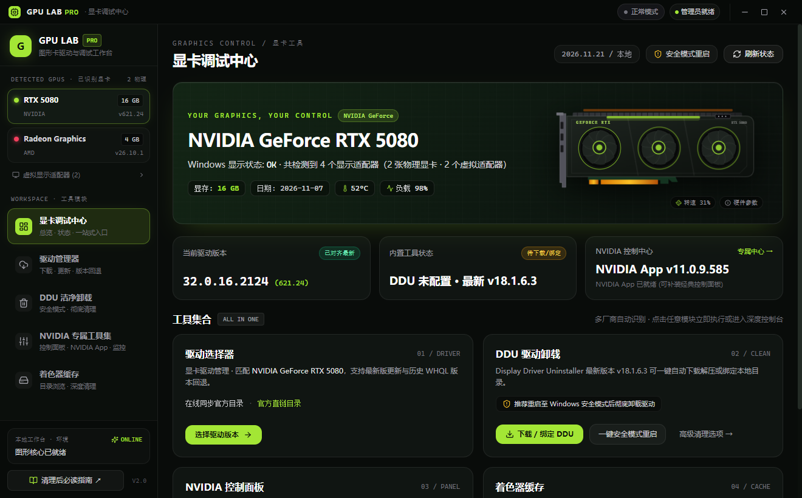
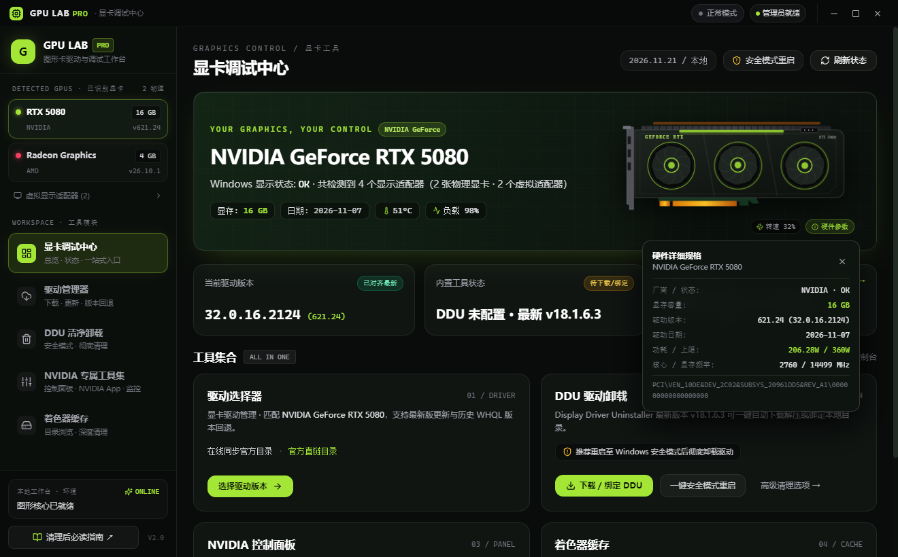
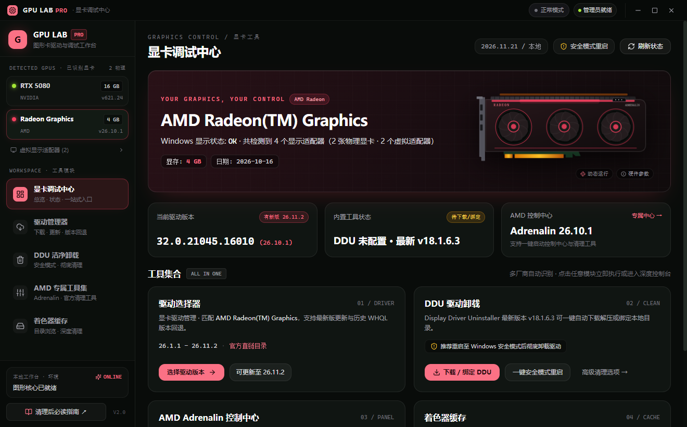
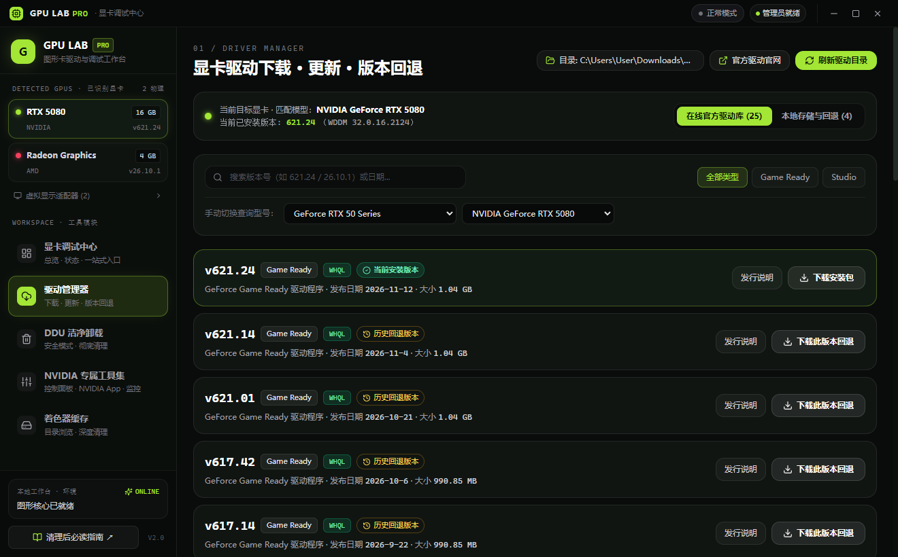
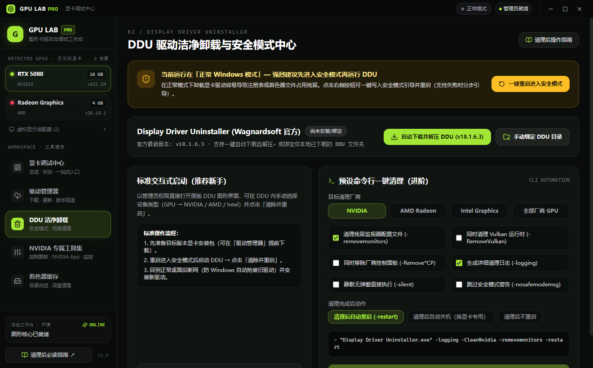
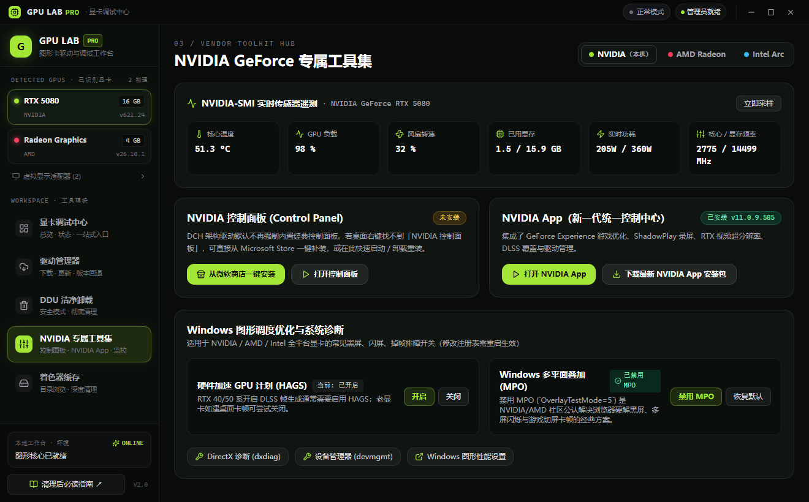
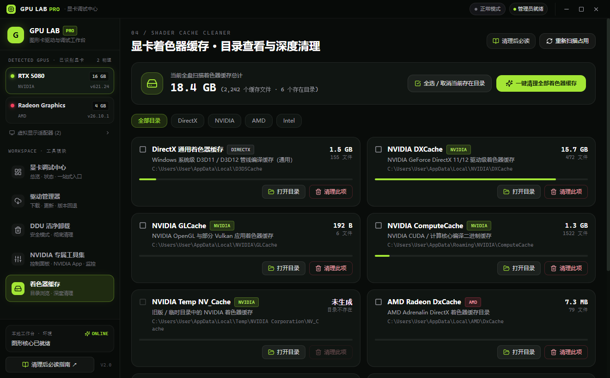
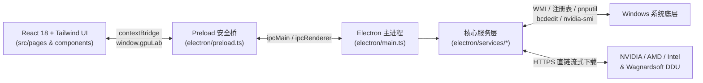

<div align="center">


# GPU LAB Pro · 显卡工具箱

**多厂商（NVIDIA / AMD / Intel）显卡驱动管理、DDU 安全模式洁净卸载、控制中心调度与着色器缓存调试工作台**

[](https://github.com/213LD/GPU-LAB-Pro/releases/latest)
[](https://github.com/213LD/GPU-LAB-Pro/releases/latest)
[](#%EF%B8%8F-项目文件地图与系统架构)
[](LICENSE)

[立即下载单文件便携版 (.exe)](https://github.com/213LD/GPU-LAB-Pro/releases/latest) · [功能展示](#-图文界面预览) · [注意事项](#%EF%B8%8F-注意事项与安全操作指南) · [文件地图](#%EF%B8%8F-项目文件地图与系统架构)

</div>

---

## ✨ 核心功能亮点

**GPU LAB Pro** 为解决游戏玩家与硬件折腾用户「换驱动、清缓存、进安全模式、找控制面板」的痛点而设计，提供一站式可视化调试方案：

| 模块 | 核心能力 |
| :--- | :--- |
| **🖥️ 多厂商智能识别与可动显卡模型** | 基于 WMI + 注册表 `HardwareInformation.qwMemorySize` 精准读取 64 位显存（杜绝 8GB/16GB+ 大显存溢出误报），自动分离物理显卡与 Parsec/GameViewer 等虚拟显示适配器；支持 **NVIDIA / AMD / Intel** 主题色自动切换，并提供多叶风扇转速联动、悬停加速测试与硬件详细规格浮层。 |
| **📥 驱动下载 · 更新 · 版本回退** | **NVIDIA** 直连官方型号库与驱动接口（支持 Game Ready / Studio 筛选与手动换卡查询）；**AMD** 内置经校验的 Adrenalin WHQL 直链目录；**Intel** 提供 Arc/Iris Xe 目录与官方入口；支持实时限速/进度条下载托盘，以及基于 `pnputil` 的本地 Windows 驱动存储库重新部署与设备管理器回退。 |
| **🧹 DDU 洁净卸载与安全模式中心** | 自动探测 Wagnardsoft 官方最新版 DDU，支持**一键下载并静默自解压**，也支持**手动绑定本地 DDU 目录**；实时检测系统是否运行在安全模式，支持**一键配置 `bcdedit` 重启进入安全模式**与安全模式下**一键恢复正常启动**；若系统受限无法自动配置，自动提供分步手动引导及 `ms-settings:recovery` / `msconfig` 快捷入口。 |
| **🎛️ 厂商专属工具集 & 系统图形排障** | **NVIDIA**：`nvidia-smi` 实时温度/负载/风扇/显存/功耗/频率遥测、微软商店一键补装经典 NVIDIA 控制面板、一键启动/卸载，以及 NVIDIA App 启动/下载；<br>**AMD**：Adrenalin 控制中心检测启动、官方 AMD Cleanup Utility 一键下载运行；<br>**Intel**：Graphics Software / Arc Control / IGCC 检测启动与商店安装；<br>**通用优化**：Windows **HAGS（硬件加速 GPU 计划）**与 **MPO（多平面叠加防黑屏闪屏）** 开关及 `dxdiag` / `devmgmt` 快捷入口。 |
| **🔥 着色器缓存扫描与深度清理** | 自动扫描 DirectX（`D3DSCache`）、NVIDIA（`DXCache` / `GLCache` / `ComputeCache` / `NV_Cache`）、AMD（`DxCache` / `GLCache` / `VkCache`）与 Intel（`ShaderCache`）共 9 个核心目录，支持逐项打开资源管理器、勾选局部清理或一键全清（安全跳过占用文件不崩溃），并在清理后弹出「两步必做操作指南」。 |

---

## 📸 图文界面预览

### 1. 显卡调试中心总览（NVIDIA GeForce RTX 5080 实机界面）

> 一体化仪表盘：集成硬件动态模型、实时温度/负载/风扇状态、驱动版本、DDU 就绪状态、控制中心及 2×2 四大核心工具快捷入口。

<p align="center">
  
</p>

### 2. 核心模块细节展示

<table>
  <tr>
    <td width="50%" align="center">
      
      <br />
      <sub><b>可动显卡交互与硬件详细规格浮层</b><br />点击显卡模型或「硬件参数」展开显存、驱动、实时功耗/频率与 PCI 设备 ID</sub>
    </td>
    <td width="50%" align="center">
      
      <br />
      <sub><b>多卡一键切换与 AMD Radeon 绯红主题</b><br />侧边栏点击 AMD 核显/独显立即切换整套 UI 主题与专属控制面板入口</sub>
    </td>
  </tr>
  <tr>
    <td width="50%" align="center">
      
      <br />
      <sub><b>驱动管理器（更新 / 历史回退 / 本地 INF 库）</b><br />自动标注「可更新新版 / 当前版本 / 历史回退」，支持内置高速下载与运行</sub>
    </td>
    <td width="50%" align="center">
      
      <br />
      <sub><b>DDU 驱动洁净卸载与安全模式管理</b><br />支持一键重启进安全模式、自动下载解压 DDU 及图形/预设命令行清理</sub>
    </td>
  </tr>
  <tr>
    <td width="50%" align="center">
      
      <br />
      <sub><b>厂商专属工具集 & HAGS / MPO 排障</b><br />集成实时遥测、微软商店一键补装 NVCP、NVIDIA App 及 HAGS/MPO 开关</sub>
    </td>
    <td width="50%" align="center">
      
      <br />
      <sub><b>着色器缓存多目录扫描与深度清理</b><br />精准统计 DirectX / NVIDIA / AMD / Intel 各缓存体积，支持打开目录与局部清理</sub>
    </td>
  </tr>
</table>

---

## 🚀 下载与快速开始

### 普通玩家（免安装单文件版）

1. 前往 [**GitHub Releases 页面**](https://github.com/213LD/GPU-LAB-Pro/releases/latest) 下载最新便携版单文件 **`GPU-LAB-Pro-2.0.0.exe`**。
2. 双击直接运行即可（无需安装 Node.js 或额外运行库）。
3. 如需执行 `bcdedit` 安全模式配置、本地驱动安装或注册表优化，请右键「**以管理员身份运行**」或在系统弹出 UAC 提示时点击确认。

### 开发者（源码运行与二次构建）

> 环境要求：**Windows 10 / 11 (x64)**、**Node.js 20+**

```powershell
# 1. 克隆仓库
git clone https://github.com/213LD/GPU-LAB-Pro.git
cd GPU-LAB-Pro

# 2. 安装依赖（国内网络建议附加 Electron 镜像）
$env:ELECTRON_MIRROR="https://npmmirror.com/mirrors/electron/"
npm install

# 3. 开发模式（Vite 热重载 + Electron 窗口）
npm run dev

# 4. 或直接构建并打包单个便携 .exe（输出到 release/GPU-LAB-Pro-2.0.0.exe）
$env:ELECTRON_BUILDER_BINARIES_MIRROR="https://npmmirror.com/mirrors/electron-builder-binaries/"
$env:CSC_IDENTITY_AUTO_DISCOVERY="false"
npm run pack:exe

# 5. 运行无损只读后端自检（检测 GPU / 官方驱动接口 / DDU / 缓存扫描）
npm run verify:services
```

也可以直接双击仓库根目录的 [`启动 GPU LAB.bat`](启动%20GPU%20LAB.bat) 一键构建并启动应用。

---

## ⚠️ 注意事项与安全操作指南

> [!WARNING]
> **进入安全模式前的关键检查（非常重要）**
> 1. **BitLocker 密钥**：如果你的系统盘开启了 BitLocker 磁盘加密，修改 BCD 安全引导重启前请务必确认微软账户或安全位置已备份 **BitLocker 恢复密钥**。
> 2. **登录密码**：部分 Windows 11 系统在安全模式下无法使用 Windows Hello 人脸/指纹或 PIN 码，可能需要输入**微软账户密码**或本地账户密码登录。
> 3. **退出安全模式**：在安全模式下完成 DDU 卸载后，请重新打开本工具顶部或 DDU 页面的「安全模式管理」点击**「清除引导并重启回正常模式」**，避免每次开机都进入安全模式。

> [!IMPORTANT]
> **清理着色器缓存或 DDU 清理驱动后，请完成这两步**
> 1. **重启计算机**：让 Windows 重新初始化图形驱动堆栈并彻底释放被系统占用的旧着色器句柄。
> 2. **在游戏平台中验证游戏文件完整性**：避免因旧着色器索引或管线配置残余导致游戏报错、贴图丢失或闪退（如 Steam 右键游戏 → 属性 → 已安装文件 → 验证游戏文件的完整性）。
> 3. 清理完毕首次进入游戏时，着色器需要**重新编译**，头几分钟出现短暂掉帧属于正常现象。

> [!TIP]
> **DDU 重装驱动防抢装建议 & 排障技巧**
> - 建议先在「驱动管理器」提前下载好目标版本的安装包，在安全模式下运行 DDU 清理，回到正常桌面时**临时拔掉网线或关闭 Wi-Fi** 再安装下载好的驱动，防止 Windows Update 在后台自动抢装旧版公版驱动。
> - **HAGS（硬件加速 GPU 计划）** 与 **MPO（禁用多平面叠加）** 修改的是系统级注册表键值，点击切换后**需要重启电脑才会生效**；如出现异常可随时在本工具内一键恢复系统默认。
> - 本软件为开源免费工具且未使用商业付费代码签名证书，下载首次运行如遇到 Windows SmartScreen「未知发布者」提示，点击「更多信息 → 仍要运行」前，可在 Release 页面核对 `.exe` 的 **SHA-256 校验值**。

---

## 🗺️ 项目文件地图与系统架构

### 系统调用架构



### 目录结构速查

```text
GPU-LAB-Pro/
├── build/
│   └── icon.ico                        # 多分辨率 Windows 应用图标 (256/128/64/48/32/16px)
├── docs/
│   ├── logo.png                        # 项目品牌图标 (256x256 PNG)
│   └── screenshots/                    # README 实机运行截图 (01 ~ 07)
├── electron/
│   ├── main.ts                         # Electron 主进程、无边框窗口控制、IPC 路由注册与自检入口
│   ├── preload.ts                      # 安全隔离上下文，向渲染层暴露 window.gpuLab API
│   ├── types.ts                        # 前后端共享领域模型与 IPC 类型定义
│   └── services/
│       ├── psRunner.ts                 # UTF-16LE Base64 PowerShell 执行器与管理员权限检测
│       ├── configService.ts            # 本地配置文件持久化 (userData/config.json)
│       ├── gpuDetector.ts              # WMI + 注册表 64 位显存 + nvidia-smi 实时遥测采集
│       ├── driverService.ts            # NVIDIA 实时接口 / AMD & Intel 目录 / 流式下载 / pnputil 存储库
│       ├── dduService.ts               # Wagnardsoft DDU 版本解析、下载自解压、目录绑定与 bcdedit 安全模式控制
│       ├── vendorToolsService.ts       # 三大厂商控制面板检测启动、微软商店调起、HAGS & MPO 注册表调节
│       └── shaderCacheService.ts       # DirectX / NVIDIA / AMD / Intel 9 目录着色器缓存扫描与安全清理
├── src/
│   ├── App.tsx                         # 全局状态管理、动态厂商主题切换 (data-vendor)、消息提示与弹窗调度
│   ├── index.css                       # 三大厂商 CSS 主题变量、风扇旋转动画与深色战术网格样式
│   ├── main.tsx                        # React 渲染入口
│   ├── types/
│   │   └── gpu.ts                      # 前端类型定义、字节/速率格式化与厂商元数据映射
│   ├── components/
│   │   ├── TitleBar.tsx                # 自定义无边框暗黑标题栏（安全模式/管理员徽标 + 窗口按钮）
│   │   ├── Sidebar.tsx                 # 品牌区、多卡物理/虚拟适配器切换器、模块化导航与指南入口
│   │   ├── GpuVisualCard.tsx           # 可动硬件显卡 SVG 渲染（RTX/Radeon/Arc）与硬件参数浮层
│   │   ├── PostCleanupModal.tsx        # 「清理后，请完成这两步」操作指南弹窗
│   │   ├── SafeModeModal.tsx           # 一键安全模式重启确认与手动分步引导弹窗
│   │   └── DownloadTray.tsx            # 全局悬浮下载任务托盘（进度、速率、取消、定位、运行安装）
│   └── pages/
│       ├── OverviewPage.tsx            # 显卡调试中心总览（Hero 卡片 + KPI 状态条 + 2x2 工具集合）
│       ├── DriverManagerPage.tsx       # 驱动下载 / 更新 / 历史回退 / 本地驱动存储部署页面
│       ├── DduPage.tsx                 # DDU 洁净卸载与安全模式状态工作台
│       ├── VendorHubPage.tsx           # NVIDIA / AMD / Intel 专属工具集与 HAGS/MPO 排障中心
│       └── ShaderCachePage.tsx         # 着色器缓存扫描、资源管理器定位与局部/全量清理页面
├── scripts/
│   ├── dev.mjs                         # Vite + Electron 联合开发启动脚本
│   ├── generate-icon.mjs               # 零依赖生成多尺寸 icon.ico 与 docs/logo.png
│   └── verify-services.mjs             # 无损后端服务与真实硬件接口验证脚本
├── 启动 GPU LAB.bat                    # Windows 一键构建并启动脚本
├── index.html                          # 前端 HTML 挂载页
├── package.json                        # 依赖清单、构建命令与 electron-builder 打包配置
├── tailwind.config.js                  # Tailwind CSS 主题字体配置
├── tsconfig.json                       # 渲染进程 TypeScript 配置
├── tsconfig.electron.json              # 主进程 TypeScript 编译配置
├── vite.config.ts                      # Vite 6 打包配置
├── LICENSE                             # MIT 开源许可证
└── README.md                           # 项目文档与图文使用指南
```

---

## 📄 开源协议与致谢

- 本项目基于 [MIT License](LICENSE) 开源，仅供个人学习、电脑装机调试与公益分享使用，严禁用于任何恶意捆绑或商业倒卖。
- 致敬 [**Wagnardsoft Display Driver Uninstaller (DDU)**](https://www.wagnardsoft.com/display-driver-uninstaller-ddu) 长期以来为全球 PC 玩家提供的免费开源底层驱动清理工具。
- 本工具不内置、不魔改任何显卡厂商驱动安装包，所有驱动与控制组件均直连 NVIDIA / AMD / Intel / Microsoft Store 官方渠道获取。
